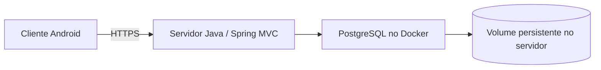

# Análise e spec — Distribuição Android do Controle Financeiro

> **Versão:** 1.3 · **Atualização:** 06/11/2026 · **Criação:** 29/10/2026.
> **Status:** PWA e projeto Android implementados; SDK instalado após aceite do usuário e APK debug gerado, com assinatura verificada e lint sem erros. Instalação em aparelho, integração TWA por HTTPS e release de produção pendentes. Sem domínio, o APK abre a tela de preparação.
> **Relacionados:** [spec do app](spec-app-controle-financeiro.md) e [PostgreSQL/Docker](spec-postgresql-docker-persistencia.md).
> **Recomendação inicial:** manter backend Java/MVC e criar distribuição Android por Trusted Web Activity (TWA), após publicar a webapp com HTTPS e preparar sua experiência PWA.

## 1. O que significa gerar um APK neste projeto

A aplicação atual é um servidor Spring Boot que processa regras, acessa banco e renderiza HTML via Thymeleaf. O artefato Maven é um JAR de servidor. Gerar um APK exige um projeto Android cliente que acesse esse servidor ou uma implementação móvel própria. O fato de ambos usarem Java não transforma o JAR Spring em aplicativo Android.

Arquitetura proposta:



O APK não contém banco PostgreSQL, Docker, credenciais JDBC ou o servidor completo. O telefone acessa a webapp por HTTPS. A disponibilidade depende do servidor e da internet; uso offline com edição e sincronização seria outro escopo.

## 2. Diagnóstico e lacunas atuais

| Área | Estado identificado | Necessário |
|---|---|---|
| Interface | Responsiva, com navegação móvel e formulários MVC | Homologação real no Android, teclado, navegação e downloads |
| Backend | Java 21/Spring Boot; HTTP local | Servidor acessível ao telefone, domínio, HTTPS e operação contínua |
| Login | Cookie de sessão, CSRF, limite de tentativas, expiração em 30 min | Testar ciclo completo no cliente Android e após retorno do segundo plano |
| Sessões | Em memória na aplicação | Informar novo login após restart; persistência de sessão é evolução separada |
| Instalação web | Sem manifest, ícones ou service worker em `static` | Preparação PWA para a proposta TWA |
| Android | Sem módulo Android, Gradle Wrapper, manifesto nativo ou chaves | Criar projeto, toolchain e assinatura |
| Exportação | CSV/ZIP autenticados | Confirmar download, abertura e compartilhamento no dispositivo |
| Identidade visual | Nome provisório e marca textual | Nome final, applicationId, ícones e splash |
| Distribuição | Nenhuma configurada | Decidir APK interno, loja ou ambos |

Na inspeção, `adb` e `gradle` não foram encontrados no PATH; Android SDK e Android Studio não foram encontrados nos locais padrão consultados. Isso não prova ausência em outros diretórios. Java 21 instalado para o backend não comprova compatibilidade com a toolchain Android a escolher. Validar JDK, Android Gradle Plugin, Gradle Wrapper e SDK em conjunto.

## 3. Alternativas

| Caminho | Reaproveitamento do MVC | Mudanças principais | Avaliação para este app |
|---|---|---|---|
| PWA instalada pelo navegador | Alto | Manifest, ícones, HTTPS e experiência de instalação | Útil por si só; não gera APK |
| TWA + Bubblewrap | Alto | Preparação web/PWA, domínio verificado, projeto Android e assinatura | Recomendado para primeira distribuição conectada |
| Android Java/Kotlin com WebView | Alto | Container nativo, cookies, navegação, downloads, permissões e segurança da WebView | Alternativa para distribuição interna com mais responsabilidade no cliente |
| Capacitor com frontend local | Parcial | Cliente estático compilável, API autenticada e integração nativa | Adequado se houver necessidade concreta de plugins/nativo |
| Cliente nativo completo | Backend/regra reaproveitados | Telas Android, API, autenticação e testes próprios | Maior esforço; indicado se experiência nativa/offline for requisito |

TWA apresenta conteúdo web pelo navegador compatível e verifica a relação entre domínio e aplicativo com Digital Asset Links. Essa proposta aproveita a renderização no servidor sem exigir nova API para cada tela. É uma conclusão de adequação ao código atual, apoiada no funcionamento descrito na [documentação TWA](https://developer.chrome.com/docs/android/trusted-web-activity).

Uma WebView permite carregar a webapp, mas exige implementar e testar explicitamente navegação, JavaScript necessário, links externos e ciclo de vida. Não habilitar ponte JavaScript nativa sem necessidade. [WebView Android](https://developer.android.com/develop/ui/views/layout/webapps/webview).

**Capacitor não é uma conversão direta das Views Thymeleaf.** Sua opção `server.url` é documentada para live reload e não para produção; apontar essa configuração ao servidor como solução definitiva não é a recomendação desta análise. Um cliente Capacitor de produção precisaria de assets web locais e contratos de API apropriados, com desenho de autenticação entre origens. [Configuração do Capacitor](https://capacitorjs.com/docs/config).

## 4. Escopo Android proposto

Primeira entrega: app conectado, com as mesmas funcionalidades da webapp, servidor compartilhado com o acesso pelo navegador e persistência central em PostgreSQL. Não duplicar regras financeiras no APK.

Não incluir nesta etapa: biometria, notificações push, leitura de SMS, acesso a contatos, integração bancária, pagamento nativo ou banco local sincronizado. Nenhuma dessas permissões é necessária para registrar dados financeiros manualmente.

Manter backend em Java. Para o wrapper TWA, usar projeto gerado pelo Bubblewrap/Android Browser Helper; Node pode ser ferramenta de build sem se tornar runtime do servidor. Caso a opção WebView seja adotada, o módulo Android pode ser implementado em Java, com toolchain Android própria.

## 5. Pré-requisitos comuns

Docker e PostgreSQL 18.6 foram instalados e validados localmente em 06/11/2026, conforme a [spec de persistência](spec-postgresql-docker-persistencia.md#14-resultado-da-implementação-local--06112026). Reutilizar esse ambiente; em outro PC, executar o diagnóstico e a preparação pelo terminal. PostgreSQL nativo no Windows não é pré-requisito. Hospedagem externa, domínio, HTTPS e SMTP continuam pendentes; containers locais saudáveis não comprovam acesso pelo celular fora da rede.

### 5.1 Servidor acessível e HTTPS

- Hospedar a aplicação em origem estável, por exemplo `https://financas.seudominio.com`.
- Publicar certificado válido e redirecionar HTTP para HTTPS. Configurar proxy e forwarded headers apenas para infraestrutura confiável.
- Ajustar `BASE_URL`, cookies seguros, SMTP e endereço dos links de acesso.
- Usar ambiente de produção sem perfil dev, sem credenciais de teste e sem segredos no pacote Android.
- O endereço `localhost:8080` no telefone aponta para o próprio telefone. IP da rede local só serve enquanto telefone e computador tiverem conectividade; a versão release não deve depender do IP de uma máquina de desenvolvimento.

Docker/PostgreSQL resolvem a execução e persistência no servidor. O acesso externo ainda exige host disponível, DNS, HTTPS e política de backup.

### 5.2 Login, navegação e dados

- Preservar Spring Security, cookie HttpOnly e CSRF. Não trocar para JWT apenas por existir um APK.
- Validar cadastro, link de verificação, recuperação, login, logout, expiração, troca de senha e exclusão.
- Testar links de e-mail no navegador e retorno ao aplicativo; definir App Links se o produto exigir abertura direta no app.
- Não pressupor que cookies de navegador e WebView sejam compartilhados. Em TWA, o wrapper não deve ler ou copiar cookies do navegador.
- Ao voltar do segundo plano ou após a sessão expirar, redirecionar para login sem confirmar operações pendentes automaticamente.
- Implementar comportamento previsível para botão Voltar, teclado, orientação, links externos e retorno de downloads.
- Sem rede: exibir mensagem e permitir nova tentativa. Nunca mostrar pagamento salvo antes da resposta do servidor; repetir somente com a chave idempotente original.

## 6. Caminho recomendado: PWA + TWA

### 6.1 Preparação da webapp

Entregas propostas:

1. `manifest.webmanifest` com `id`, nome, nome curto, `start_url`, `scope`, cores, modo de exibição e ícones apropriados, incluindo 192/512 px e maskable.
2. Referência ao manifest nos templates e ícones para instalação. Fixar identidade visual antes da distribuição definitiva.
3. Service worker com política explícita: cache somente de assets estáticos versionados e de uma tela pública de indisponibilidade.
4. Excluir de cache offline HTML autenticado, formulários/CSRF, tokens, relatórios, exportações e respostas financeiras. Não interceptar POSTs para enfileirar escritas offline nesta versão.
5. Conferir instalação e navegação no navegador Android antes do wrapper.

Manifest e service worker são entregas propostas para uma experiência PWA consistente. Os requisitos técnicos exatos da ferramenta e do navegador devem ser confirmados na versão fixada; não presumir que instalar a PWA concede edição offline.

### 6.2 Projeto Android e relação com o domínio

Definir applicationId permanente (ex.: `br.com.suaempresa.financas`, a confirmar), nome, `versionName`, `versionCode`, origem HTTPS e certificados por ambiente. Criar projeto `android/` com Gradle Wrapper e configuração de build reproduzível.

Publicar `/.well-known/assetlinks.json` no domínio, acessível por HTTPS sem login e sem ser interceptado pela exigência global de autenticação. O arquivo contém applicationId e fingerprints SHA-256 dos certificados corretos. O conteúdo deve refletir a assinatura da distribuição real, incluindo Play App Signing quando utilizado; certificado de upload e certificado de assinatura distribuída têm funções distintas.

O Bubblewrap gera o projeto TWA a partir do manifest. A validação do domínio é parte do aceite; se falhar, pode ocorrer fallback para Custom Tab com barra do navegador. [Guia TWA/Bubblewrap](https://developer.chrome.com/docs/android/trusted-web-activity/quick-start).

Ajustar [SecurityConfig](../src/main/java/br/com/financa/config/SecurityConfig.java) para permitir apenas recursos públicos necessários: manifest, ícones, service worker e assetlinks. Manter proteção das rotas financeiras. Separar domínio e assinatura de homologação dos de produção.

### 6.3 Artefatos e assinatura

- **APK debug:** ensaio em emulador/aparelho; não é o artefato de release.
- **APK release assinado:** instalação direta/controlada.
- **AAB release assinado:** artefato previsto para submissão de aplicativo novo à Google Play; a loja entrega os APKs aos dispositivos. [Android App Bundles](https://developer.android.com/guide/app-bundle).

Gerar e guardar keystore e senhas fora do repositório. Controlar acesso, backup e recuperação da chave; atualização de uma instalação precisa manter identidade de assinatura compatível. [Assinatura Android](https://developer.android.com/studio/publish/app-signing).

Os comandos serão definidos pelo projeto gerado, por exemplo `gradlew.bat assembleDebug`, `assembleRelease` e `bundleRelease`. Confirmar variantes, versões e assinatura antes de documentá-los como executáveis. [Build por linha de comando](https://developer.android.com/build/building-cmdline).

## 7. Android mínimo e publicação

Proposta de produto: Android mínimo 8/API 26, sujeita à compatibilidade do wrapper e do navegador escolhido. `minSdk` indica aparelhos elegíveis; `targetSdk` indica a versão de comportamento visada e não deve ser confundido com o mínimo.

Na documentação oficial revalidada em 06/11/2026, novas submissões/atualizações de apps Android convencionais à Play exigem target Android 16/API 36 ou superior desde 31/08/2026. Adotar API 36 como base proposta e revalidar a regra no momento da publicação. [Requisitos oficiais de target API](https://developer.android.com/google/play/requirements/target-sdk).

Para loja: preparar ficha, ícones, capturas reais, política de privacidade pública, declaração Data Safety coerente com o app, suporte e acesso de revisão. Levantar exigências de teste conforme o tipo/estado da conta Play Console; não assumir aprovação automática de um wrapper.

A exclusão atual existe nas configurações autenticadas, mas ainda é necessário um recurso web público e identificável que permita iniciar o pedido sem reinstalar o app. Esse fluxo deve confirmar identidade antes de excluir dados. [Política de exclusão de contas da Play](https://support.google.com/googleplay/android-developer/answer/13327111).

Para distribuição interna por APK, não é necessário publicar em loja, mas continuam necessários assinatura, canal de entrega, atualização e homologação. Instalação direta e publicação em loja têm processos diferentes.

## 8. Requisitos e critérios de aceitação

| ID | Cenário | Resultado esperado |
|---|---|---|
| AN01 | Instalar APK de teste e abrir | Nome/ícone corretos e origem de homologação acessível |
| AN02 | Validar associação TWA | Domínio/certificado corretos; modo esperado sem fallback inesperado |
| AN03 | Cadastro, verificação e recuperação | Links válidos, confirmação e retorno ao acesso |
| AN04 | Login, segundo plano e expiração | Sessão correta, logout efetivo e novo login quando necessário |
| AN05 | Receitas, despesas e transferências | Mesmos dados e saldos vistos pelo navegador |
| AN06 | Compra, prévia e pagamento de fatura | Valores exatos, sem duplicação após toque repetido ou falha de rede |
| AN07 | Perder rede durante POST | Estado verificável no servidor; repetição com idempotência e sem falso sucesso |
| AN08 | Botão Voltar, teclado, retrato/paisagem e 320 px | Sem controles inacessíveis, saída acidental ou perda silenciosa de formulário |
| AN09 | CSV/ZIP autenticados | Download legível no dispositivo, sem exposição pública do arquivo |
| AN10 | Links externos e certificados inválidos | Navegação tratada; falha TLS não ignorada |
| AN11 | Logout e inspeção de cache | Sem HTML/CSRF/dados financeiros disponíveis pelo cache offline da PWA |
| AN12 | Atualizar APK release | Instalação atualizada com assinatura compatível e dados do servidor preservados |
| AN13 | Inspecionar release | Sem URL local, senha dev, credencial de banco, token fixo ou keystore embutido |
| AN14 | Exclusão dentro do app e recurso web | Fluxo disponível e remoção conforme política |
| AN15 | Instalação sem navegador TWA compatível | Fallback/aviso definido e testado, sem tela vazia |
| AN16 | Rebuild em ambiente limpo | APK/AAB gerados com toolchain e versões documentadas; assinatura protegida |

Executar em emulador e em pelo menos um aparelho Android real, cobrindo a menor versão suportada em matriz apropriada e uma versão atual. Os testes Chromium/WebKit anteriores não substituem esses testes nem validam um APK.

## 9. Arquivos e trabalho previstos

| Área | Mudança |
|---|---|
| Hospedagem/HTTPS/SMTP | Pré-requisitos compartilhados com a entrega PostgreSQL/Docker |
| `static/manifest.webmanifest`, ícones e `sw.js` | Instalação web e experiência de indisponibilidade |
| Templates e Spring Security | Inclusão e liberação dos recursos públicos necessários |
| `/.well-known/assetlinks.json` | Associação pública entre origem e assinatura Android |
| `android/` | Projeto wrapper, Gradle Wrapper, variantes, IDs e configuração de assinatura |
| Configuração de CI | Builds debug/release, segredos de assinatura e artefatos controlados |
| Web pública | Privacidade, suporte e início de exclusão de conta |
| Testes | Jornadas Android, rede, sessão, downloads e atualização |

## 10. Sequência e decisões necessárias

1. Concluir PostgreSQL/Docker e operação externa do servidor.
2. Definir domínio HTTPS e distribuição inicial: APK interno ou loja.
3. Entregar preparação PWA e validar a experiência web Android.
4. Criar prova de conceito TWA e testar login/downloads/associação do domínio.
5. Se a TWA não atender um requisito concreto, registrar o motivo e avaliar WebView ou cliente com API; não iniciar reescrita por suposição.
6. Fixar applicationId, identidade visual, toolchain e chaves.
7. Gerar APK assinado, homologar AN01–AN16 e preparar AAB caso haja publicação Play.

Estimativa qualitativa: preparação HTTPS/PWA e wrapper TWA têm esforço médio; homologação/publicação acrescentam esforço próprio. Capacitor com frontend local/API ou cliente nativo tem esforço alto em relação ao código atual. Não há prazo fechado sem definir domínio, conta de distribuição, recursos nativos e disponibilidade do ambiente Android.

As escolhas pendentes são: domínio/host e nome definitivo/applicationId. Para planejamento, adotar TWA conectada, APK assinado para instalação direta como primeira entrega, Android mínimo API 26 e AAB/Play em etapa posterior. São premissas propostas, revisáveis pelo usuário; não autorizam contratar hospedagem, publicar na loja ou cadastrar identidade definitiva.

## 11. Contrato da primeira entrega implementável

Objetivo: instalar no Android um aplicativo chamado provisoriamente **Controle Financeiro**, abrir a aplicação hospedada por HTTPS e executar as mesmas operações disponíveis na web, com persistência no PostgreSQL do servidor.

| Item | Definição proposta | Condição de entrega |
|---|---|---|
| Arquitetura | PWA + TWA com Android Browser Helper; Bubblewrap para geração | Preservar Controllers, Services, Repositories e Views atuais |
| Código Android próprio | Java, quando houver customização necessária | Sem duplicar cálculos, autenticação ou acesso JDBC |
| Instalação inicial | APK release assinado, distribuído de forma controlada | Instalação e atualização ensaiadas em aparelho real |
| Google Play | Preparação AAB; publicação em fase posterior | Não bloquear APK interno por ausência de conta Play |
| Android | `minSdk=26`, `targetSdk=36`, `compileSdk` compatível e no mínimo 36 | Confirmar suporte das dependências antes de fixar a matriz |
| Ambientes | `hml` e `prod`, com IDs, origens e assinaturas próprios | APK de produção não acessa dev nem hml |
| Identificador | `br.com.financa.controle` como exemplo; hml com sufixo `.hml` | Confirmar titularidade e ID antes da primeira distribuição release |
| Entrada | `/dashboard`, com redirecionamento normal para login sem sessão | Não conter tokens nem usuário na URL de lançamento |
| Rede | Uso conectado; mensagem pública em indisponibilidade | Sem saldo offline nem fila de operações |
| Orientação | Retrato e paisagem | Sem travar orientação para esconder falhas de layout |
| Permissões | Somente as tecnicamente necessárias à TWA | Sem permissão ampla de arquivos, câmera, contatos ou SMS |

Nenhum APK pode transportar o login dev fixo, senhas, URL JDBC, dumps, arquivos `.env`, keystore ou código/recursos exclusivos do ambiente dev. O endpoint de produção deve rejeitar a conta dev também quando acessado diretamente pelo navegador.

### 11.1 Separação de configuração e release

Manter configuração pública de exemplo em `android/config/`, sem URLs locais como defaults de release. Origem deve ser uma URL HTTPS absoluta, sem credenciais, fragmentos ou tokens. Ausência de origem, applicationId confirmado ou material de assinatura deve causar falha acionável no build release.

Debug pode ser gerado para desenvolvimento; não equivale a TWA verificada. Homologação integrada deve usar origem HTTPS própria e certificado correspondente no Digital Asset Links. Não desabilitar validação TLS ou associação de domínio para declarar AN02 aprovado. Testes locais de interface sem domínio continuam pelo navegador, separadamente do aceite Android.

`versionCode` deve crescer em cada release; `versionName` é a versão legível. APK interno e distribuição Play podem usar certificados diferentes: documentar a migração entre canais, pois não se presume atualização compatível entre assinaturas diferentes. Nunca trocar a chave apenas para resolver falha de atualização.

## 12. Preparação do PC Windows e instalação pelo terminal

Criar scripts PowerShell com diagnóstico separado de instalação, seguindo os padrões dos scripts Docker existentes. Não assumir Android Studio, SDK ou Gradle instalados. A inspeção de 06/11/2026 não encontrou `adb`, `gradle` ou `sdkmanager` no PATH; registrar como não encontrados, sem afirmar ausência em todo o disco.

### 12.1 Diagnóstico obrigatório

`scripts/check-android-environment.ps1` deve verificar e registrar, sem imprimir segredos:

- Windows/arquitetura, espaço livre e conectividade aos endpoints oficiais necessários.
- Java e JDK usado pelo backend versus JDK exigido pela toolchain Android; não substituir silenciosamente o Java do projeto.
- Node/npm para Bubblewrap, SDK configurado, platform-tools/adb, build-tools, plataforma API 36 e ferramentas de assinatura.
- Gradle pelo Wrapper versionado do projeto; Gradle global não é obrigatório.
- SDK/emulador e aceleração apenas quando for usar emulador; aparelho USB permite testar sem emulador.
- Dispositivo em estados conectado, ausente ou não autorizado. USB debugging depende de ação explícita do usuário no aparelho.
- Compatibilidade declarada entre JDK, Gradle, Android Gradle Plugin, Browser Helper e Bubblewrap. Salvar versões exatas e resultado em `data/android-environment-check.json`.

Ausência de permissão, timeout e bloqueio de rede devem aparecer como falha ou não verificado. Não aprovar diagnóstico apenas pela existência de um executável.

### 12.2 Instalação controlada e repetível

`scripts/setup-android-environment.ps1` deve diagnosticar por padrão; instalar somente com `-Install`. Baixar ferramentas de fontes oficiais, conferir checksum publicado quando disponível e reutilizar instalações compatíveis. Android Studio é opcional; permitir SDK por ferramentas de linha de comando. Não instalar PostgreSQL no telefone nem outro servidor PostgreSQL no PC.

A documentação Android consultada apresenta a Android CLI como sucessora de `sdkmanager`; escolher e fixar a ferramenta suportada na implementação. Se for usado um pacote que ainda fornece `sdkmanager`, documentar a compatibilidade. Não presumir que comandos legados são o único caminho. [Gerenciamento oficial do SDK](https://developer.android.com/tools/sdkmanager).

Exibir licenças para aceite interativo pelo usuário; não automatizar respostas afirmativas. Não alterar ExecutionPolicy global, não substituir `JAVA_HOME` permanente e não reiniciar a máquina automaticamente. Usar `ANDROID_HOME`/caminhos no processo ou orientar configuração persistente explícita. Informar retomada após instalação ou autorização USB.

Fixar dependências npm em lockfile e executar `npm ci`; fixar Gradle com `distributionSha256Sum`, AGP e dependências Android. Proibir versões dinâmicas `+` e downloads sem origem documentada. A matriz exata será registrada após o primeiro build bem-sucedido; esta spec não declara uma combinação de versões já testada.

## 13. Requisitos detalhados da webapp/PWA

### 13.1 Manifest e recursos públicos

- Manifest com `id` estável, `lang=pt-BR`, `start_url=/dashboard`, `scope=/`, `display=standalone`, nome, cores e ícones PNG 192/512 e maskable próprios.
- `sw.js` servido na raiz para escopo `/`, com revalidação que permita atualização. Fallback offline público, sem dados do usuário, com ação de tentar novamente.
- Permitir manifest, ícones, service worker, offline, privacidade, suporte e `/.well-known/assetlinks.json` explicitamente no Spring Security. Não liberar genericamente rotas privadas ou desabilitar CSRF.
- Digital Asset Links como JSON público com `Content-Type: application/json`, HTTPS e sem redirecionamento/login. Servir apenas a associação do ambiente correspondente; não publicar certificado debug na origem de produção.
- Política CSP compatível com recursos próprios, incluindo `manifest-src 'self'` e `worker-src 'self'` quando explicitados. Nenhuma dependência de scripts inline inseguros para registrar o worker.

### 13.2 Cache e privacidade

Cache Storage deve usar lista explícita de assets públicos versionados. Tratar páginas autenticadas e APIs financeiras apenas pela rede; permitir fallback offline somente para falha de navegação GET, sem armazenar a resposta original. Não cachear `/auth/**`, `/me/**`, `/exports/**`, dados financeiros, query strings com token, respostas de erro privadas ou requisições POST.

Respostas autenticadas e de token devem usar `Cache-Control: no-store`; validar também o histórico/Voltar após logout. Não persistir formulários, saldos, CSRF ou sessão em IndexedDB/localStorage. Limpar caches antigos próprios na ativação, sem apagar caches de outros aplicativos. Atualização do worker não deve recarregar uma tela financeira durante envio nem repetir POST.

A TWA usa o navegador: o wrapper não controla todos os seus dados, arquivos baixados ou cookies. Não prometer apagar downloads já salvos no aparelho ao excluir a conta. Confirmar comportamento real após logout e documentar limitações de capturas de tela e dispositivo compartilhado.

### 13.3 Sessão, downloads e falha de rede

Manter autenticação por cookie HttpOnly/Secure em HTTPS, proteção CSRF e isolamento entre titulares. Não ler cookies no wrapper nem passar tokens pelo Android Intent. O perfil do navegador que atende a TWA pode compartilhar sessão com a navegação web; isso é comportamento a homologar, não uma sessão isolada presumida.

Exportações existentes: `/exports/transactions`, `/exports/report` e `/me/export`. Preservar autenticação, MIME, nome do arquivo e `Content-Disposition`. Ensaiar download pelo navegador provedor da TWA, abertura pelo seletor Android e retorno ao app. Falha nessa jornada impede aceite; não criar URL pública temporária com dados financeiros para contornar cookies.

Após perda de conexão em uma escrita, informar que o resultado precisa ser conferido. Consultar o estado online antes de oferecer repetição; conservar a chave idempotente quando repetir a mesma operação. Se a sessão expirar, solicitar login e exigir nova confirmação de ação financeira. Não reproduzir automaticamente o corpo do POST após autenticação.

Links de confirmação/recuperação devem funcionar no navegador mesmo sem APK instalado. App Links ficam opcionais na primeira entrega; se implementados, limitar host/path e testar mensagens encaminhadas, links expirados e intents com URL externa. Links externos abrem com identificação da origem pelo navegador.

## 14. Build, assinatura, instalação e entrega

### 14.1 Scripts previstos

| Script | Responsabilidade |
|---|---|
| `check-android-environment.ps1` | Diagnóstico sem mutação e relatório JSON |
| `setup-android-environment.ps1` | Instalação explícita e retomada |
| `build-android.ps1` | Validar configuração, executar Wrapper, gerar APK ou AAB, checksum e metadados |
| `install-android.ps1` | Listar dispositivos, exigir seleção se houver mais de um, instalar via adb |
| `verify-android-domain.ps1` | Verificar HTTPS, manifest, assetlinks, package e fingerprint esperados |

O build não inicia, encerra ou recria o banco de produção. A criação inicial de chave deve ser uma ação explícita; builds normais nunca geram outra chave silenciosamente. Senhas não podem aparecer em argumentos de processo, histórico do terminal, logs ou artefatos. Usar configuração local ignorada pelo Git/secret store de CI, com acesso restrito e cópia de recuperação separada.

### 14.2 Roteiro esperado após implementação

Os comandos abaixo são contratos dos scripts a criar, não comandos disponíveis hoje:

```powershell
powershell.exe -NoProfile -ExecutionPolicy Bypass -File scripts/check-android-environment.ps1
powershell.exe -NoProfile -ExecutionPolicy Bypass -File scripts/setup-android-environment.ps1 -Install
powershell.exe -NoProfile -ExecutionPolicy Bypass -File scripts/verify-android-domain.ps1 -Environment hml
powershell.exe -NoProfile -ExecutionPolicy Bypass -File scripts/build-android.ps1 -Environment hml -BuildType Debug -Artifact Apk
powershell.exe -NoProfile -ExecutionPolicy Bypass -File scripts/install-android.ps1 -ApkPath CAMINHO_DO_APK -Serial SERIAL_DO_APARELHO
powershell.exe -NoProfile -ExecutionPolicy Bypass -File scripts/build-android.ps1 -Environment prod -BuildType Release -Artifact Apk
```

O script de build deve mapear opções às tarefas reais geradas, listadas em `android/gradlew.bat tasks`. Não presumir nomes de flavors antes de configurar o projeto. Android permite executar build e instalação pelo Gradle Wrapper/adb, sem exigir abertura da IDE. [Build oficial por terminal](https://developer.android.com/build/building-cmdline).

### 14.3 Artefatos e distribuição

Entregar APK assinado, SHA-256 e relatório com commit de origem, ambiente, applicationId, versionCode/versionName, origem HTTPS, toolchain e fingerprint público do certificado. Verificar a assinatura com `apksigner verify --verbose --print-certs`. AAB deve ter assinatura validada com ferramenta apropriada a bundles/JAR; `apksigner` não valida AAB.

Gerar em `android/app/build/outputs/` e copiar somente os artefatos destinados à entrega para diretório ignorado pelo Git. Não declarar builds byte a byte idênticos sem verificar; o requisito inicial é rebuild funcional com dependências fixadas e procedência registrada.

Disponibilizar APK por canal HTTPS controlado. Documentar a autorização de instalação para a fonte escolhida no aparelho, sem pedir desativação ampla de proteções. Nunca desinstalar automaticamente uma versão existente para resolver assinatura incompatível. Atualização usa mesmo ID e assinatura compatível, versionCode maior e mantém os dados financeiros no servidor.

CI sem chaves gera debug e executa lint/testes/configuração. Release usa job manual protegido com segredos de assinatura; não disponibilizar chaves a pull requests de forks. Upload para loja não é consequência automática do build. Registros de teste não podem publicar extratos, cookies, tokens ou dados pessoais reais.

## 15. Aceite adicional e plano de execução

Complementar AN01–AN16 com os critérios abaixo. Cada resultado deve registrar versão Android, modelo/emulador, navegador provedor, versão do app, ambiente e evidência sem dados pessoais.

| ID | Verificação | Aceite |
|---|---|---|
| AN17 | PC sem ferramentas Android | Diagnóstico identifica ausência; instalação oficial pelo terminal e build posterior documentados |
| AN18 | PC já preparado | Reutiliza SDK/JDK compatíveis, sem reinstalar nem sobrescrever configuração |
| AN19 | Licença, rede, USB ou permissão pendente | Falha explicada, ponto de retomada e nenhum falso sucesso |
| AN20 | Build release incompleto | Falha sem HTTPS, identidade ou assinatura; nunca substitui por dados dev |
| AN21 | Manifest, worker, offline e associação | Acesso público sem afrouxar autenticação de dados financeiros |
| AN22 | Inspeção de armazenamento | Cache Storage contém somente recursos públicos; nenhuma fila financeira offline |
| AN23 | APK hml e prod instalados | IDs/origens distintos, sem confusão de dados ou certificado debug em produção |
| AN24 | Rebuild em outra máquina/CI | Wrapper e lockfiles usados, assinatura e metadados verificáveis |
| AN25 | Acessibilidade e interface Android | Texto ampliado, TalkBack, teclado e alvos de toque utilizáveis; barras do sistema não cobrem controles |
| AN26 | Instalação direta e atualização | APK validado instala e atualiza no aparelho, com canal e assinatura documentados |

Executar pelo menos em API 26 e API 36 ou versão estável mais recente suportada, com um aparelho físico além dos emuladores. Testar rede móvel/Wi-Fi, modo avião, retorno de segundo plano, encerramento do processo, reinício do servidor, dois usuários e sessão expirada. Datas/valores devem respeitar a configuração do usuário, independentemente do fuso do aparelho. API 26 permanece condicionada à disponibilidade de provedor TWA compatível; se não for viável, elevar o mínimo explicitamente e atualizar a matriz.

Sequência de implementação:

1. Preparar diagnóstico, configuração por ambiente e documentação da toolchain; pode avançar sem domínio definitivo.
2. Implementar PWA, política de cache, páginas públicas e testes Spring/navegador, preservando o MVC.
3. Gerar módulo Android e APK debug; registrar limitações enquanto não existir domínio de homologação.
4. Disponibilizar origem HTTPS hml, associar certificado e executar prova TWA de login/downloads. Essa etapa depende da escolha do host.
5. Confirmar identidade definitiva, provisionar assinatura com recuperação e gerar APK release.
6. Homologar AN01–AN26, entregar APK/checksum/guia e registrar resultados. Preparar AAB e requisitos Play somente quando esse canal for solicitado.

Pronto para instalar e usar significa APK release verificado, servidor HTTPS acessível pelo aparelho, jornadas aprovadas, atualização ensaiada e guia de operação entregue. Gerar apenas um APK debug ou abrir a página responsiva não satisfaz esse aceite. Publicação em loja tem aceite próprio e permanece separada da instalação direta.

## 16. Histórico

| Versão | Data | Alteração |
|---|---|---|
| 1.0 | 29/10/2026 | Análise de alternativas e proposta PWA/TWA |
| 1.1 | 06/11/2026 | Spec executável para APK: estado PostgreSQL atualizado, preparação Windows por terminal, ambientes, cache, build, assinatura, instalação, CI e AN17–AN26 |
| 1.2 | 06/11/2026 | Preparação PWA/Android implementada; evidências e bloqueios de compilação/homologação na seção 17 |
| 1.3 | 06/11/2026 | Aceite do SDK autorizado pelo usuário, SDK instalado e APK debug gerado/verificado; evidências na seção 18 |

## 17. Evidências da preparação — 06/11/2026

- PWA implementada com manifest, ícones 192/512/maskable, service worker e página pública offline. Cache permite somente ícones e offline; HTML privado e POST não são armazenados.
- Associação Android pública configurável por ambiente, páginas de privacidade/suporte preparatórias e recurso web de início de exclusão. Rotas privadas e CSRF preservados.
- Módulo `android/` em Java, Android Browser Helper 2.6.2, AGP 8.13.2, Gradle 8.13 com checksum oficial, minSdk 26 e target/compileSdk 36. Configuração direta da biblioteca TWA substitui a geração por Bubblewrap, dispensando Node no build Android sem alterar a arquitetura proposta.
- Debug sem origem mostra tela de preparação. Release exige HTTPS, identidade confirmada e assinatura. Scripts de diagnóstico, instalação interativa do SDK, build/verificação, associação e instalação USB estão em `scripts/`; instruções em [docs/android.md](../docs/android.md).
- `mvn.cmd verify spotless:check`: 30 testes aprovados e um teste opcional de carga H2 ignorado, incluindo três testes novos Android/PWA. Checkstyle e Spotless aprovados. Evidência local: `target/android-web-verification.log`.
- Chromium móvel: login dev, Cache Storage exclusivamente público, fallback sem conexão, retorno online e bloqueio após logout aprovados (`scripts/pwa-check.cjs`), usando instância temporária com banco em memória.
- `gradlew tasks --all`: configuração do projeto e resolução do plugin aprovadas, conforme `target/android-gradle-configuration.log`. Esse resultado não equivale à compilação ou ao lint Android.
- Dependências transitivas fixadas em `android/app/gradle.lockfile`; AndroidX Browser 1.9.0 estável substitui a versão alpha transitiva do Browser Helper. Resolução em `target/android-dependencies-final.log`.
- SDK/adb não encontrados no diagnóstico local; o instalador exige aceite interativo dos termos/licenças. O usuário confirmou que ainda não tem domínio. Não foi gerado nem instalado APK e nenhum AN dependente de aparelho/TWA foi declarado aprovado.
- Pendências: instalar SDK com aceite do usuário, compilar e executar lint, gerar APK debug, configurar servidor HTTPS, confirmar identidade/assinatura release e homologar AN01–AN26 em emulador/aparelho. Privacidade e suporte precisam dos dados reais do operador antes de produção.

## 18. SDK e APK debug — 06/11/2026

O usuário aceitou explicitamente os termos do SDK e autorizou a instalação após a preparação acima. Instalados SDK Command-Line Tools build 15859902 (checksum oficial verificado), plataforma Android 36, Build Tools 36.0.0 e platform-tools/adb 37.0.1. O instalador foi corrigido para extrair caminhos longos com `jar` do JDK, sem alterar configurações globais do Windows, e solicitar somente licenças dos pacotes necessários.

`build-android.ps1 -Environment hml -BuildType Debug -Artifact Apk` concluiu compilação, `lintDebug` e verificação de assinatura. Artefato: `artifacts/android/hml/debug/app-debug.apk`, versão `0.1.0-debug`, ID `br.com.financa.controle.hml`, minSdk 26 e targetSdk 36; checksum e metadados ao lado do APK. Textos da tela nativa foram movidos para recursos Android. O lint reportou 0 erros e 2 avisos documentados em [docs/android.md](../docs/android.md).

A inspeção do APK confirmou apenas internet e uma permissão interna de receptor não exportado do AndroidX. Assinatura debug v2 válida. A tarefa `validateFinanceRelease` foi ensaiada sem origem/identidade e falhou pelo motivo esperado, registrado em `target/android-release-guard.log`.

Não havia aparelho autorizado/conectado; emulador não instalado. Não declarar instalação, abertura no aparelho, associação TWA, downloads autenticados ou AN01–AN26 completos. Ainda é necessário domínio HTTPS, confirmar identidade/assinatura de produção e homologar a experiência conectada. Nenhum AAB ou APK release foi gerado.
