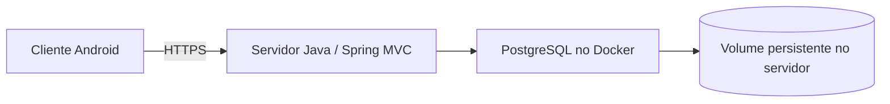

# Análise e spec — Distribuição Android do Controle Financeiro

> **Versão:** 1.0 · **Data:** 29/10/2026.
> **Status:** análise técnica e proposta; nenhum APK/AAB gerado.
> **Relacionados:** [spec do app](spec-app-controle-financeiro.md) e [PostgreSQL/Docker](spec-postgresql-docker-persistencia.md).
> **Recomendação inicial:** manter backend Java/MVC e criar distribuição Android por Trusted Web Activity (TWA), após publicar a webapp com HTTPS e preparar sua experiência PWA.

## 1. O que significa gerar um APK neste projeto

A aplicação atual é um servidor Spring Boot que processa regras, acessa banco e renderiza HTML via Thymeleaf. O artefato Maven é um JAR de servidor. Gerar um APK exige um projeto Android cliente que acesse esse servidor ou uma implementação móvel própria. O fato de ambos usarem Java não transforma o JAR Spring em aplicativo Android.

Arquitetura proposta:

O APK não contém banco PostgreSQL, Docker, credenciais JDBC ou o servidor completo. O telefone acessa a webapp por HTTPS. A disponibilidade depende do servidor e da internet; uso offline com edição e sincronização seria outro escopo.

## 2. Diagnóstico e lacunas atuais

| Área | Estado identificado | Necessário |
|---|---|---|
| Interface | Responsiva, com navegação móvel e formulários MVC | Homologação real no Android, teclado, navegação e downloads |
| Backend | Java 21/Spring Boot; HTTP local | Servidor acessível ao telefone, domínio, HTTPS e operação contínua |
| Login | Cookie de sessão, CSRF, limite de tentativas, expiração em 30 min | Testar ciclo completo no cliente Android e após retorno do segundo plano |
| Sessões | Em memória na aplicação | Informar novo login após restart; persistência de sessão é evolução separada |
| Instalação web | Sem manifest, ícones ou service worker em `static` | Preparação PWA para a proposta TWA |
| Android | Sem módulo Android, Gradle Wrapper, manifesto nativo ou chaves | Criar projeto, toolchain e assinatura |
| Exportação | CSV/ZIP autenticados | Confirmar download, abertura e compartilhamento no dispositivo |
| Identidade visual | Nome provisório e marca textual | Nome final, applicationId, ícones e splash |
| Distribuição | Nenhuma configurada | Decidir APK interno, loja ou ambos |

Na inspeção, `adb` e `gradle` não foram encontrados no PATH; Android SDK e Android Studio não foram encontrados nos locais padrão consultados. Isso não prova ausência em outros diretórios. Java 21 instalado para o backend não comprova compatibilidade com a toolchain Android a escolher. Validar JDK, Android Gradle Plugin, Gradle Wrapper e SDK em conjunto.

## 3. Alternativas

| Caminho | Reaproveitamento do MVC | Mudanças principais | Avaliação para este app |
|---|---|---|---|
| PWA instalada pelo navegador | Alto | Manifest, ícones, HTTPS e experiência de instalação | Útil por si só; não gera APK |
| TWA + Bubblewrap | Alto | Preparação web/PWA, domínio verificado, projeto Android e assinatura | Recomendado para primeira distribuição conectada |
| Android Java/Kotlin com WebView | Alto | Container nativo, cookies, navegação, downloads, permissões e segurança da WebView | Alternativa para distribuição interna com mais responsabilidade no cliente |
| Capacitor com frontend local | Parcial | Cliente estático compilável, API autenticada e integração nativa | Adequado se houver necessidade concreta de plugins/nativo |
| Cliente nativo completo | Backend/regra reaproveitados | Telas Android, API, autenticação e testes próprios | Maior esforço; indicado se experiência nativa/offline for requisito |

TWA apresenta conteúdo web pelo navegador compatível e verifica a relação entre domínio e aplicativo com Digital Asset Links. Essa proposta aproveita a renderização no servidor sem exigir nova API para cada tela. É uma conclusão de adequação ao código atual, apoiada no funcionamento descrito na [documentação TWA](https://developer.chrome.com/docs/android/trusted-web-activity).

Uma WebView permite carregar a webapp, mas exige implementar e testar explicitamente navegação, JavaScript necessário, links externos e ciclo de vida. Não habilitar ponte JavaScript nativa sem necessidade. [WebView Android](https://developer.android.com/develop/ui/views/layout/webapps/webview).

**Capacitor não é uma conversão direta das Views Thymeleaf.** Sua opção `server.url` é documentada para live reload e não para produção; apontar essa configuração ao servidor como solução definitiva não é a recomendação desta análise. Um cliente Capacitor de produção precisaria de assets web locais e contratos de API apropriados, com desenho de autenticação entre origens. [Configuração do Capacitor](https://capacitorjs.com/docs/config).

## 4. Escopo Android proposto

Primeira entrega: app conectado, com as mesmas funcionalidades da webapp, servidor compartilhado com o acesso pelo navegador e persistência central em PostgreSQL. Não duplicar regras financeiras no APK.

Não incluir nesta etapa: biometria, notificações push, leitura de SMS, acesso a contatos, integração bancária, pagamento nativo ou banco local sincronizado. Nenhuma dessas permissões é necessária para registrar dados financeiros manualmente.

Manter backend em Java. Para o wrapper TWA, usar projeto gerado pelo Bubblewrap/Android Browser Helper; Node pode ser ferramenta de build sem se tornar runtime do servidor. Caso a opção WebView seja adotada, o módulo Android pode ser implementado em Java, com toolchain Android própria.

## 5. Pré-requisitos comuns

### 5.1 Servidor acessível e HTTPS

- Hospedar a aplicação em origem estável, por exemplo `https://financas.seudominio.com`.
- Publicar certificado válido e redirecionar HTTP para HTTPS. Configurar proxy e forwarded headers apenas para infraestrutura confiável.
- Ajustar `BASE_URL`, cookies seguros, SMTP e endereço dos links de acesso.
- Usar ambiente de produção sem perfil dev, sem credenciais de teste e sem segredos no pacote Android.
- O endereço `localhost:8080` no telefone aponta para o próprio telefone. IP da rede local só serve enquanto telefone e computador tiverem conectividade; a versão release não deve depender do IP de uma máquina de desenvolvimento.

Docker/PostgreSQL resolvem a execução e persistência no servidor. O acesso externo ainda exige host disponível, DNS, HTTPS e política de backup.

### 5.2 Login, navegação e dados

- Preservar Spring Security, cookie HttpOnly e CSRF. Não trocar para JWT apenas por existir um APK.
- Validar cadastro, link de verificação, recuperação, login, logout, expiração, troca de senha e exclusão.
- Testar links de e-mail no navegador e retorno ao aplicativo; definir App Links se o produto exigir abertura direta no app.
- Não pressupor que cookies de navegador e WebView sejam compartilhados. Em TWA, o wrapper não deve ler ou copiar cookies do navegador.
- Ao voltar do segundo plano ou após a sessão expirar, redirecionar para login sem confirmar operações pendentes automaticamente.
- Implementar comportamento previsível para botão Voltar, teclado, orientação, links externos e retorno de downloads.
- Sem rede: exibir mensagem e permitir nova tentativa. Nunca mostrar pagamento salvo antes da resposta do servidor; repetir somente com a chave idempotente original.

## 6. Caminho recomendado: PWA + TWA

### 6.1 Preparação da webapp

Entregas propostas:

1. `manifest.webmanifest` com `id`, nome, nome curto, `start_url`, `scope`, cores, modo de exibição e ícones apropriados, incluindo 192/512 px e maskable.
2. Referência ao manifest nos templates e ícones para instalação. Fixar identidade visual antes da distribuição definitiva.
3. Service worker com política explícita: cache somente de assets estáticos versionados e de uma tela pública de indisponibilidade.
4. Excluir de cache offline HTML autenticado, formulários/CSRF, tokens, relatórios, exportações e respostas financeiras. Não interceptar POSTs para enfileirar escritas offline nesta versão.
5. Conferir instalação e navegação no navegador Android antes do wrapper.

Manifest e service worker são entregas propostas para uma experiência PWA consistente. Os requisitos técnicos exatos da ferramenta e do navegador devem ser confirmados na versão fixada; não presumir que instalar a PWA concede edição offline.

### 6.2 Projeto Android e relação com o domínio

Definir applicationId permanente (ex.: `br.com.suaempresa.financas`, a confirmar), nome, `versionName`, `versionCode`, origem HTTPS e certificados por ambiente. Criar projeto `android/` com Gradle Wrapper e configuração de build reproduzível.

Publicar `/.well-known/assetlinks.json` no domínio, acessível por HTTPS sem login e sem ser interceptado pela exigência global de autenticação. O arquivo contém applicationId e fingerprints SHA-256 dos certificados corretos. O conteúdo deve refletir a assinatura da distribuição real, incluindo Play App Signing quando utilizado; certificado de upload e certificado de assinatura distribuída têm funções distintas.

O Bubblewrap gera o projeto TWA a partir do manifest. A validação do domínio é parte do aceite; se falhar, pode ocorrer fallback para Custom Tab com barra do navegador. [Guia TWA/Bubblewrap](https://developer.chrome.com/docs/android/trusted-web-activity/quick-start).

Ajustar [SecurityConfig](../src/main/java/br/com/financa/config/SecurityConfig.java) para permitir apenas recursos públicos necessários: manifest, ícones, service worker e assetlinks. Manter proteção das rotas financeiras. Separar domínio e assinatura de homologação dos de produção.

### 6.3 Artefatos e assinatura

- **APK debug:** ensaio em emulador/aparelho; não é o artefato de release.
- **APK release assinado:** instalação direta/controlada.
- **AAB release assinado:** artefato previsto para submissão de aplicativo novo à Google Play; a loja entrega os APKs aos dispositivos. [Android App Bundles](https://developer.android.com/guide/app-bundle).

Gerar e guardar keystore e senhas fora do repositório. Controlar acesso, backup e recuperação da chave; atualização de uma instalação precisa manter identidade de assinatura compatível. [Assinatura Android](https://developer.android.com/studio/publish/app-signing).

Os comandos serão definidos pelo projeto gerado, por exemplo `gradlew.bat assembleDebug`, `assembleRelease` e `bundleRelease`. Confirmar variantes, versões e assinatura antes de documentá-los como executáveis. [Build por linha de comando](https://developer.android.com/build/building-cmdline).

## 7. Android mínimo e publicação

Proposta de produto: Android mínimo 8/API 26, sujeita à compatibilidade do wrapper e do navegador escolhido. `minSdk` indica aparelhos elegíveis; `targetSdk` indica a versão de comportamento visada e não deve ser confundido com o mínimo.

Na documentação consultada em 29/10/2026, novas submissões/atualizações de apps Android convencionais à Play exigem target Android 16/API 36 ou superior desde 31/08/2026. Revalidar essa regra no momento da publicação. [Requisitos oficiais de target API](https://support.google.com/googleplay/android-developer/answer/11926878).

Para loja: preparar ficha, ícones, capturas reais, política de privacidade pública, declaração Data Safety coerente com o app, suporte e acesso de revisão. Levantar exigências de teste conforme o tipo/estado da conta Play Console; não assumir aprovação automática de um wrapper.

A exclusão atual existe nas configurações autenticadas, mas ainda é necessário um recurso web público e identificável que permita iniciar o pedido sem reinstalar o app. Esse fluxo deve confirmar identidade antes de excluir dados. [Política de exclusão de contas da Play](https://support.google.com/googleplay/android-developer/answer/13327111).

Para distribuição interna por APK, não é necessário publicar em loja, mas continuam necessários assinatura, canal de entrega, atualização e homologação. Instalação direta e publicação em loja têm processos diferentes.

## 8. Requisitos e critérios de aceitação

| ID | Cenário | Resultado esperado |
|---|---|---|
| AN01 | Instalar APK de teste e abrir | Nome/ícone corretos e origem de homologação acessível |
| AN02 | Validar associação TWA | Domínio/certificado corretos; modo esperado sem fallback inesperado |
| AN03 | Cadastro, verificação e recuperação | Links válidos, confirmação e retorno ao acesso |
| AN04 | Login, segundo plano e expiração | Sessão correta, logout efetivo e novo login quando necessário |
| AN05 | Receitas, despesas e transferências | Mesmos dados e saldos vistos pelo navegador |
| AN06 | Compra, prévia e pagamento de fatura | Valores exatos, sem duplicação após toque repetido ou falha de rede |
| AN07 | Perder rede durante POST | Estado verificável no servidor; repetição com idempotência e sem falso sucesso |
| AN08 | Botão Voltar, teclado, retrato/paisagem e 320 px | Sem controles inacessíveis, saída acidental ou perda silenciosa de formulário |
| AN09 | CSV/ZIP autenticados | Download legível no dispositivo, sem exposição pública do arquivo |
| AN10 | Links externos e certificados inválidos | Navegação tratada; falha TLS não ignorada |
| AN11 | Logout e inspeção de cache | Sem HTML/CSRF/dados financeiros disponíveis pelo cache offline da PWA |
| AN12 | Atualizar APK release | Instalação atualizada com assinatura compatível e dados do servidor preservados |
| AN13 | Inspecionar release | Sem URL local, senha dev, credencial de banco, token fixo ou keystore embutido |
| AN14 | Exclusão dentro do app e recurso web | Fluxo disponível e remoção conforme política |
| AN15 | Instalação sem navegador TWA compatível | Fallback/aviso definido e testado, sem tela vazia |
| AN16 | Rebuild em ambiente limpo | APK/AAB gerados com toolchain e versões documentadas; assinatura protegida |

Executar em emulador e em pelo menos um aparelho Android real, cobrindo a menor versão suportada em matriz apropriada e uma versão atual. Os testes Chromium/WebKit anteriores não substituem esses testes nem validam um APK.

## 9. Arquivos e trabalho previstos

| Área | Mudança |
|---|---|
| Hospedagem/HTTPS/SMTP | Pré-requisitos compartilhados com a entrega PostgreSQL/Docker |
| `static/manifest.webmanifest`, ícones e `sw.js` | Instalação web e experiência de indisponibilidade |
| Templates e Spring Security | Inclusão e liberação dos recursos públicos necessários |
| `/.well-known/assetlinks.json` | Associação pública entre origem e assinatura Android |
| `android/` | Projeto wrapper, Gradle Wrapper, variantes, IDs e configuração de assinatura |
| Configuração de CI | Builds debug/release, segredos de assinatura e artefatos controlados |
| Web pública | Privacidade, suporte e início de exclusão de conta |
| Testes | Jornadas Android, rede, sessão, downloads e atualização |

## 10. Sequência e decisões necessárias

1. Concluir PostgreSQL/Docker e operação externa do servidor.
2. Definir domínio HTTPS e distribuição inicial: APK interno ou loja.
3. Entregar preparação PWA e validar a experiência web Android.
4. Criar prova de conceito TWA e testar login/downloads/associação do domínio.
5. Se a TWA não atender um requisito concreto, registrar o motivo e avaliar WebView ou cliente com API; não iniciar reescrita por suposição.
6. Fixar applicationId, identidade visual, toolchain e chaves.
7. Gerar APK assinado, homologar AN01–AN16 e preparar AAB caso haja publicação Play.

Estimativa qualitativa: preparação HTTPS/PWA e wrapper TWA têm esforço médio; homologação/publicação acrescentam esforço próprio. Capacitor com frontend local/API ou cliente nativo tem esforço alto em relação ao código atual. Não há prazo fechado sem definir domínio, conta de distribuição, recursos nativos e disponibilidade do ambiente Android.

As escolhas pendentes são: domínio/host, nome definitivo/applicationId, canal de distribuição, Android mínimo e necessidade de recursos nativos/offline. O recomendado nesta versão é TWA conectada; a escolha final deve ser registrada antes do módulo Android de release.
