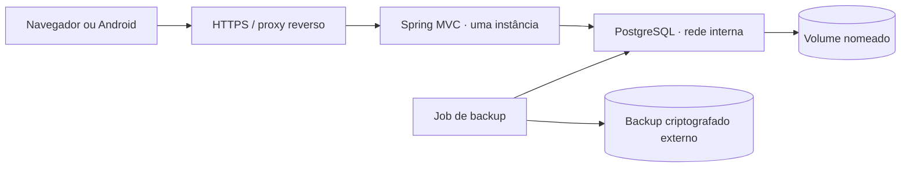

# Spec — PostgreSQL em Docker com persistência e migração do H2

> **Versão:** 1.0 · **Data:** 29/10/2026.
> **Status:** especificado; implementação e homologação ainda não executadas.
> **Origem:** pedido do usuário para adotar PostgreSQL e Docker com persistência.
> **Dependência:** [spec principal](spec-app-controle-financeiro.md).
> **Complexidade:** média para banco novo; alta quando inclui migração dos dados existentes e recuperação operacional.

## 1. Objetivo e escopo

Executar a aplicação Java MVC com PostgreSQL em container, preservando dados após reiniciar ou recriar containers e mantendo a separação entre desenvolvimento e produção. Entregar também migrações, testes reais de PostgreSQL, backup e restauração verificáveis.

O PostgreSQL armazena os registros; o volume Docker armazena os arquivos do banco fora do ciclo de vida do container. A cópia de recuperação fica em armazenamento independente. Volumes persistem fora do container, mas não oferecem por si só recuperação de perda do computador ou do disco. [Volumes Docker](https://docs.docker.com/engine/storage/volumes/).

Esta entrega não inclui hospedagem contratada, cluster, alta disponibilidade, Kubernetes, replicação nem funcionamento offline. A etapa Android está em [spec de APK](spec-android-apk.md).

## 2. Diagnóstico do repositório

| Área | Existe hoje | Trabalho restante |
|---|---|---|
| Dependências | Driver JDBC PostgreSQL, Spring JDBC, Flyway e módulo Flyway PostgreSQL em [pom.xml](../pom.xml) | Fixar matriz testada de versões e validar o banco real |
| Banco padrão | H2 em arquivo em [application.properties](../src/main/resources/application.properties) | Perfil PostgreSQL sem fallback silencioso para H2 |
| Desenvolvimento | [application-dev.properties](../src/main/resources/application-dev.properties) usa `DEV_DATABASE_URL` e banco H2 separado | Configurar o dev PostgreSQL sem confundir variáveis de produção |
| Schema | Migrações V1 a V4; V4 marca a conta dev | Aplicar desde banco vazio em PostgreSQL e validar constraints/índices |
| Consultas | SQL parametrizado, `FOR UPDATE`, agregações, `LIMIT`, datas e transações | Verificar tipos retornados, concorrência, locks e desempenho no PostgreSQL |
| Backup | [BackupService](../src/main/java/br/com/financa/service/BackupService.java) aceita somente H2 e usa `SCRIPT TO` | Fluxo PostgreSQL com `pg_dump`/`pg_restore`, criptografia e agendamento |
| Testes | Integração em H2; carga usa `RANDOM_UUID()` e `SYSTEM_RANGE` | Suite PostgreSQL com Testcontainers; fixtures portáveis |
| Android/web | Backend acessível por HTTP local; sessões em memória | HTTPS e endereço estável para uso externo |
| Docker | Nenhum Dockerfile, Compose ou `.dockerignore` no projeto | Criar build, serviços, volumes, healthchecks e documentação |

Na inspeção, `docker` não foi localizado no PATH. Não foi comprovada a existência de um daemon Docker ativo. Instalação e capacidade de executar containers devem ser verificadas antes da implementação; esta spec não instala ferramentas nem altera o banco em execução.

**Ponto importante:** definir apenas `DATABASE_URL` hoje não muda a URL do perfil `dev`, porque esse perfil tem configuração própria baseada em `DEV_DATABASE_URL`.

## 3. Arquitetura alvo



Três modos documentados:

1. **Desenvolvimento:** banco no Docker; Java pode rodar na IDE/host ou em container; perfil `dev` explícito.
2. **Homologação:** app e banco em containers, sem credenciais dev; serviços de e-mail de teste.
3. **Produção:** app e banco em containers, proxy HTTPS, SMTP real e backups externos; uma instância da aplicação inicialmente.

O Docker Desktop/Engine precisa permanecer em execução. Containers locais não tornam o serviço público nem mantêm o app disponível quando o computador estiver desligado.

## 4. Requisitos de infraestrutura

| ID | Requisito |
|---|---|
| PG01 | Subir PostgreSQL e aplicação por Docker Compose com configuração reproduzível |
| PG02 | Usar volume nomeado explícito para o banco e identificá-lo na documentação |
| PG03 | Preservar contas, lançamentos, cartões, auditoria e idempotência após recriação dos containers |
| PG04 | Separar bancos, volumes, credenciais e nomes de projeto Compose por ambiente |
| PG05 | Executar Flyway antes de aceitar tráfego financeiro; falhar se schema ou conexão estiverem inválidos |
| PG06 | Não criar usuário dev nem permitir seu login em homologação/produção |
| PG07 | Executar testes críticos no mesmo major de PostgreSQL da implantação |
| PG08 | Gerar backup completo diário criptografado e comprovar restauração independente |
| PG09 | Oferecer migração H2 → PostgreSQL opcional, explícita e reconciliada |
| PG10 | Documentar inicialização, parada, atualização, recuperação e limites operacionais |

## 5. Docker e persistência

### 5.1 Imagens e diretórios

Proposta: PostgreSQL **18**, com patch e digest fixados na implementação; evitar `latest`. Para a aplicação, build multiestágio Maven/JDK 21 e runtime Java 21, também com versões registradas. Executar a aplicação com usuário sem privilégios e copiar apenas o artefato necessário.

Na imagem oficial PostgreSQL 18, montar o volume em **`/var/lib/postgresql`**; o diretório de dados padrão fica sob `18/docker`. Não copiar cegamente a montagem de versões anteriores. Confirmar esses caminhos na tag efetivamente fixada. [Imagem oficial PostgreSQL](https://hub.docker.com/_/postgres).

Volumes propostos, com escopo pelo nome do projeto Compose:

- `postgres_data`: arquivos ativos do PostgreSQL.
- `backup_staging`: artefatos temporários restritos; cópia final vai para armazenamento independente.
- `dev_mail`: e-mails em arquivo apenas no desenvolvimento, se a aplicação também estiver em container.

Manter o nome de projeto estável: `financas-dev`, `financas-hml` e `financas-prod`. Trocar o nome pode selecionar outro volume e aparentar perda dos dados. Registrar ambiente, volume e localização do backup no inventário operacional.

### 5.2 Rede e disponibilidade

- A aplicação em container conecta a `db:5432`. Na IDE/host conecta à porta publicada, por exemplo `localhost:5432`.
- Em desenvolvimento, publicar banco somente em `127.0.0.1` quando necessário à IDE.
- Em produção, não publicar a porta do banco na internet; expor apenas o proxy HTTPS.
- Definir healthcheck `pg_isready` e dependência `service_healthy`. `depends_on` sem healthcheck não garante prontidão do banco. [Inicialização no Compose](https://docs.docker.com/compose/how-tos/startup-order/).
- Prontidão da aplicação deve refletir conexão e schema aplicados, sem divulgar credenciais. Definir endpoint restrito para o healthcheck; hoje não há Actuator no `pom.xml`.
- Configurar timeout e política de reinício; testar recuperação de conexão após reiniciar o banco. Healthcheck de inicialização não substitui recuperação durante a execução.

### 5.3 Ciclo de vida

Os comandos abaixo são **contratos da futura entrega**, dependentes dos arquivos Compose ainda não criados:

```powershell
docker compose -p financas-dev --env-file .env.dev -f compose.yaml -f compose.dev.yaml up -d --build
docker compose -p financas-dev --env-file .env.dev -f compose.yaml -f compose.dev.yaml ps
docker compose -p financas-dev --env-file .env.dev -f compose.yaml -f compose.dev.yaml down
```

Recriar containers ou executar `down` sem remoção de volumes deve preservar os dados. Não incluir `down -v`, `volume prune` ou exclusão de volumes em procedimentos normais. Uma eventual limpeza destrutiva precisa identificar o volume e ter autorização específica.

## 6. Configuração, credenciais e perfis

Criar `application-postgres.properties` e `application-prod.properties`. O perfil PostgreSQL exige URL e credenciais válidas; na ausência delas, a aplicação deve encerrar em vez de criar um H2 vazio.

No Compose, usar as propriedades Spring de maior precedência `SPRING_DATASOURCE_URL`, `SPRING_DATASOURCE_USERNAME` e `SPRING_DATASOURCE_PASSWORD`, ou equivalente por arquivo secreto, evitando dependência da ordem de carregamento dos perfis. Documentar a relação com as variáveis `DATABASE_*` e `DEV_DATABASE_*` existentes. Não manter duas URLs efetivas sem informar qual prevalece.

| Configuração | Dev | Produção |
|---|---|---|
| Perfis Spring | `dev,postgres` | `prod,postgres` |
| Credencial dev do app | Permitida no banco isolado | Bloqueada e sem inicializador |
| `BASE_URL` | Endereço acessível ao dispositivo em teste | Origem HTTPS pública e estável |
| Cookies seguros | Conforme HTTPS do teste | `Secure`, `HttpOnly` e política SameSite validada |
| E-mail | Arquivo persistente ou servidor de teste | SMTP com entrega validada |
| Templates | Cache desativado para desenvolvimento | Cache ativado |
| Tarefas | Uma instância | Uma instância; coordenação necessária para escalar |

A conta inicial criada por `POSTGRES_USER` na imagem oficial tem poder administrativo; ela não deve ser a credencial do app. Variáveis e scripts de inicialização da imagem atuam apenas sobre diretório vazio; trocar a senha no `.env` não altera automaticamente um banco já inicializado. [Inicialização da imagem oficial](https://hub.docker.com/_/postgres).

Separar credenciais administrativas, migração e runtime. Flyway usa a credencial de migração; runtime recebe DML e permissões necessárias às tabelas, sem superusuário ou criação arbitrária de schema. Definir grants para objetos futuros. Scripts de bootstrap só criam banco/papéis; tabelas e evolução pertencem ao Flyway.

Entregar `.env.example` sem valores reais. Arquivos `.env` são configuração do Compose; não são carregados automaticamente pelo Java fora dele. Em produção, montar segredos e usar mecanismo compatível do Spring, como config tree. Nenhuma senha entra em Dockerfile, imagem, APK, Git ou saída de diagnóstico.

## 7. Homologação SQL e Flyway

1. Aplicar V1–V4 em PostgreSQL vazio e executar `validate`.
2. Conferir `BIGINT`, booleanos, `DATE`, `TIMESTAMP WITH TIME ZONE`, nomes e tipos das colunas retornados pelo JDBC.
3. Testar constraints compostas por titular, unicidades, cascatas, limites monetários e índices.
4. Validar agregações e `CAST(CONCAT(...))` dos relatórios, ordenação de nulos, filtros inclusivos e datas no fuso do usuário.
5. Validar `FOR UPDATE`, isolamento de leitura, duas operações concorrentes e rollback da auditoria.
6. Tratar deadlocks/conflitos transitórios com resposta ou repetição limitada e idempotente; não repetir cegamente comandos financeiros.

Não alterar migrações já aplicadas em H2 para tentar corrigir um PostgreSQL novo. Se surgir incompatibilidade nas migrações iniciais, registrar a decisão: preservar o histórico H2 existente e fornecer cadeia inicial específica por fornecedor/localização Flyway. Nova migração só resolve o problema se a cadeia anterior conseguir executá-la. Nunca habilitar `baseline-on-migrate` apenas para esconder divergência.

## 8. Dados H2 existentes

Há dois caminhos, ambos explícitos:

- **Banco novo:** iniciar PostgreSQL vazio e manter H2 preservado. Nenhuma informação é migrada implicitamente.
- **Migração com preservação:** executar utilitário H2 → PostgreSQL, com escrita suspensa, origem preservada e destino inicialmente vazio.

O banco H2 normal e o banco H2 dev são origens diferentes. Não transportar a conta dev para produção. A exportação CSV/ZIP do usuário é útil para consulta, mas não é backup completo de autenticação: não contém hashes de senha nem todos os metadados necessários.

### 8.1 Procedimento de migração proposto

1. Inventariar origem, usuários, operações e schema; fazer backup verificado; impedir novas escritas.
2. Preparar destino por Flyway e validar que não contém dados de negócio.
3. Ler por JDBC e gravar em lotes na ordem das dependências, preservando IDs, hashes de senha, versões, centavos, datas, titularidade, auditoria e idempotência.
4. Rejeitar registros dev em destino de produção, inconsistências e duplicidades; não truncar ou arredondar valores silenciosamente.
5. Recriar o histórico Flyway a partir das migrações do destino, sem copiar a tabela de controle H2. Invalidar tokens de verificação/recuperação e sessões, comunicando a necessidade de novo login ou reenvio de link.
6. Reconciliar contagens e conteúdo por entidade; conferir saldo por conta, compras/parcelas, total de cada fatura e resultado por mês. Contagem igual sozinha não basta.
7. Emitir relatório sem segredos e liberar tráfego apenas após aprovação da reconciliação.

Falha deve deixar o destino identificado como não liberado. A repetição só é aceita sobre destino vazio ou após detectar, pelo manifesto da migração, uma execução já concluída e idêntica; não fazer importação cumulativa. Não automatizar limpeza de dados sem autorização. Após iniciar escritas no PostgreSQL, voltar ao H2 requer reconciliar essas escritas; não é rollback instantâneo.

## 9. Backup e recuperação PostgreSQL

Substituir a execução H2 agendada por estratégia dependente do banco ou job operacional PostgreSQL. Não deixar o agendamento atual falhar diariamente tentando executar `SCRIPT TO` em PostgreSQL.

Proposta: `pg_dump` em formato custom (`-Fc`), cliente compatível com o major do servidor, arquivo local restrito, criptografia autenticada e envio para destino separado. Restaurar com `pg_restore` em banco independente e reconstruir os papéis/grants operacionais. Um dump oferece snapshot consistente; formato custom permite restauração seletiva. [Backup lógico PostgreSQL](https://www.postgresql.org/docs/current/backup-dump.html).

No PowerShell, evitar redirecionar o dump binário por pipeline textual. Gerar arquivo com `--file` dentro do container/job e transferir por mecanismo que preserve bytes. Backups grandes devem ser processados por streaming, evitando carregar tudo em memória como ocorre no backup H2 atual.

Metas herdadas: RPO de até 24h, RTO de até 8h e retenção máxima proposta de 90 dias, a formalizar. Agendar fora do ciclo do container da aplicação, registrar último sucesso e tamanho, detectar falhas e testar restauração periodicamente. Volume e backup no mesmo disco não atendem à recuperação de perda desse disco.

## 10. Testes e critérios de aceitação

Usar PostgreSQL real em Testcontainers no CI e na integração local, com imagem alinhada à implantação. Docker indisponível deve falhar na etapa PostgreSQL obrigatória do CI, e não virar teste silenciosamente ignorado. Testes puros de domínio podem continuar sem containers. [Módulo PostgreSQL do Testcontainers](https://java.testcontainers.org/modules/databases/postgres/).

| ID | Verificação | Aceite |
|---|---|---|
| CP01 | Subir ambiente limpo | Banco pronto, Flyway aplicado, app responde sem dados fictícios em produção |
| CP02 | Criar dados e recriar containers | Mesmos IDs, saldos, faturas e auditoria; login funciona |
| CP03 | `down` e novo `up` com mesmo projeto/volume | Dados preservados |
| CP04 | Reiniciar o computador/daemon | Após iniciar Docker e serviços, dados intactos |
| CP05 | Executar dev e produção isolados | Volumes e usuários distintos; conta dev bloqueada em produção |
| CP06 | Ausência de configuração PostgreSQL | Inicialização falha, sem fallback para H2 |
| CP07 | Rodar testes CA01–CA22 da spec no PostgreSQL | Resultados financeiros, autorização e concorrência preservados |
| CP08 | Duas requisições de pagamento/edição | Um efeito financeiro; repetição idempotente ou conflito controlado |
| CP09 | Backup e restore em volume novo | Usuários, vínculos, auditoria e saldos reconciliados |
| CP10 | Migração de cópia H2 representativa | Conteúdo e totais reconciliados; tokens antigos inválidos |
| CP11 | Falha durante migração | Destino não liberado; origem preservada; reexecução controlada |
| CP12 | 100 mil lançamentos e 20 sessões HTTP | Medir P95 no ambiente PostgreSQL e perseguir a meta de 1s; não reutilizar o número medido em H2 |
| CP13 | Inspecionar imagem e portas | Sem segredos embutidos, runtime não privilegiado e banco sem exposição pública |
| CP14 | Exclusão e expiração de backup | Remoção do titular e retenção comprovadas no novo banco |

O teste de carga atual usa SQL exclusivo de H2; substituir por geração de fixtures Java/JDBC ou estratégia específica de PostgreSQL. O teste de restauração precisa usar ferramentas PostgreSQL e validar um banco completo.

## 11. Arquivos e entregas previstos

| Arquivo/área | Entrega |
|---|---|
| `Dockerfile`, `.dockerignore` | Build Java reproduzível, runtime mínimo e exclusão de `data`, segredos, IDE e artefatos locais |
| `compose.yaml`, `compose.dev.yaml`, `compose.prod.yaml` | Serviços, rede, volumes, healthchecks e exposição por ambiente |
| `.env.example` e documentação | Variáveis e precedência; sem senha real |
| `application-postgres.properties`, `application-prod.properties` | Configuração obrigatória e defaults adequados à produção |
| Configuração dev | Compatibilidade com banco dev PostgreSQL e login dev já existente |
| `pom.xml` e testes | Testcontainers, perfil de integração PostgreSQL e métricas reais |
| Repositórios/migrações | Ajustes constatados na homologação; histórico preservado |
| Backup | Job PostgreSQL, criptografia, restore e alertas; separar o modo H2 |
| Utilitário de migração | Importação por JDBC e relatório de reconciliação |
| `README.md`, `docs/operacao.md` | Procedimentos executáveis e recuperação testada |

## 12. Sequência e definição de pronto

1. Verificar Docker/Compose e fixar imagens/versões.
2. Entregar PostgreSQL vazio com Flyway e perfis separados.
3. Containerizar app e validar persistência após recriação.
4. Executar testes PostgreSQL e corrigir diferenças de SQL/concorrência.
5. Entregar backup/restore, segredos e operação HTTPS.
6. Entregar e ensaiar migração H2, se os dados existentes forem preservados.
7. Homologar no host escolhido e atualizar a spec principal com evidências.

Pronto significa CP01–CP14 aprovados, ou CP10–CP11 explicitamente não aplicáveis por decisão de começar vazio; nenhum dado antigo apagado por suposição; backup restaurado em ambiente independente; produção sem conta dev. Ainda precisam ser definidos host/domínio, armazenamento de backup e quais bancos H2 existentes serão migrados. Essas definições não impedem implementar e testar o ambiente local.
